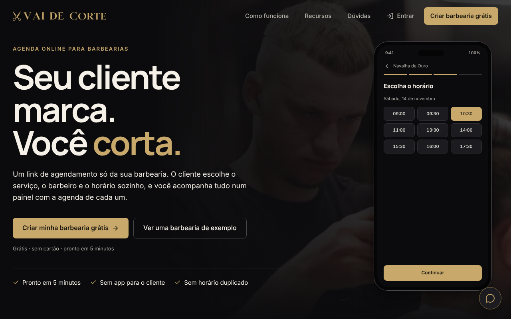
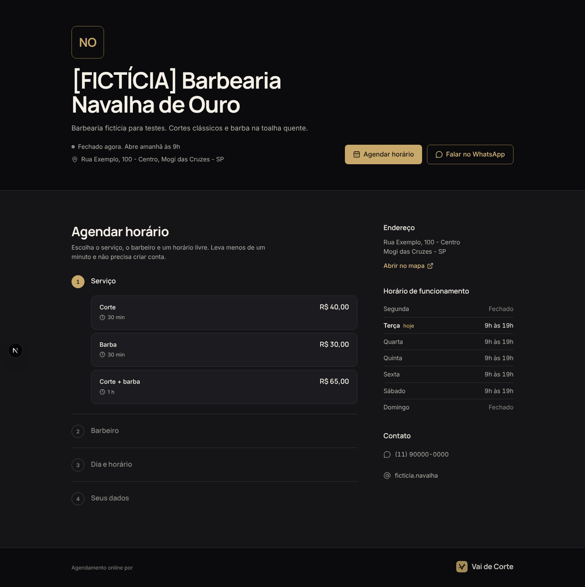
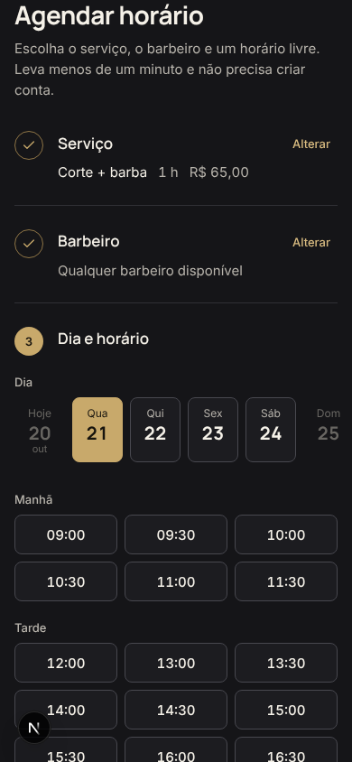
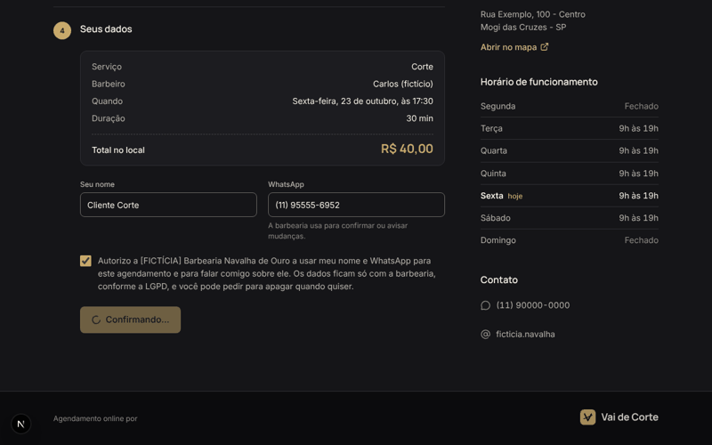
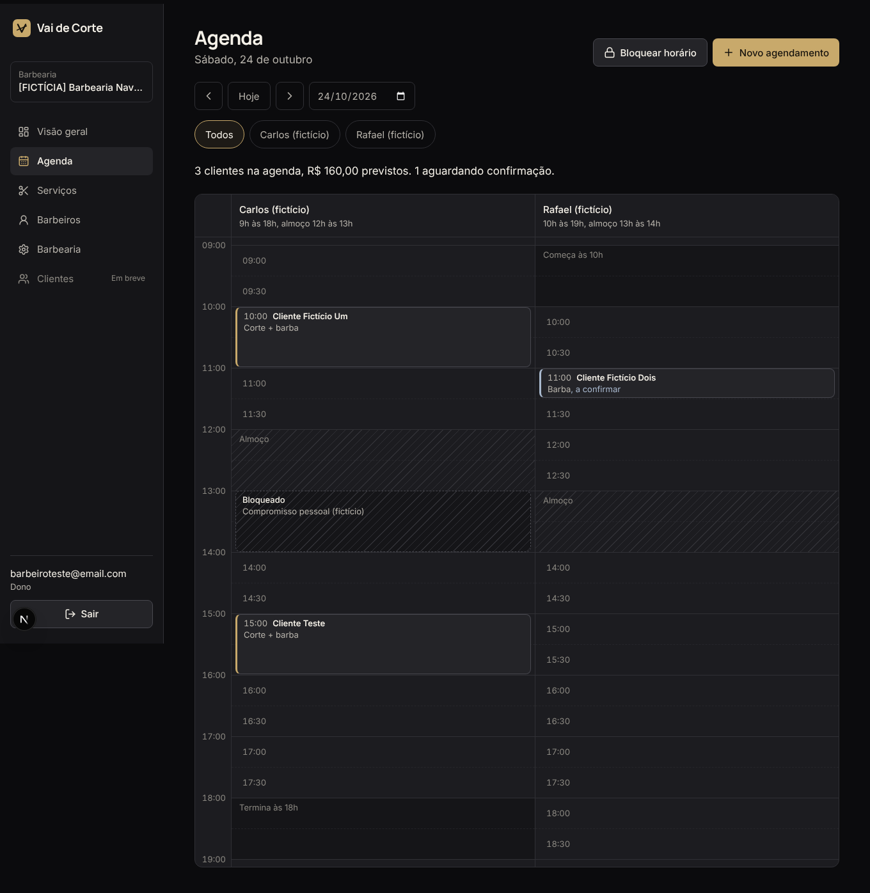
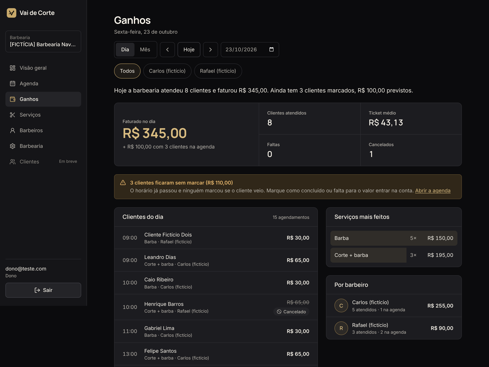

<p align="center">
  
</p>

<p align="center">
  <strong>Agendamento online para barbearias.</strong><br>
  O cliente marca sozinho por um link. O barbeiro corta.
</p>

<p align="center">
  <a href="https://vai-de-corte.vercel.app"><strong>Ver o site no ar</strong></a> ·
  <a href="https://vai-de-corte.vercel.app/barbearia/ficticia-navalha-de-ouro">Barbearia de exemplo</a> ·
  <a href="docs/guia-tecnico.md">Guia técnico</a>
</p>

<p align="center">
  
  
  
  
  
</p>



## O problema

Em barbearia pequena, quem marca horário é o próprio barbeiro, pelo WhatsApp, entre um corte e outro. Mensagem que fica sem resposta vira cliente perdido, e horário anotado de cabeça vira choque de agenda.

O **Vai de Corte** dá para cada barbearia um link próprio (`/barbearia/nome-da-barbearia`). O cliente abre pelo Instagram, pelo QR Code no balcão ou por uma mensagem, escolhe serviço, barbeiro e horário livre, e pronto: sem baixar app e sem criar conta. O dono acompanha tudo num painel com a agenda de cada barbeiro e o faturamento do dia.

Projeto do time **Programadores da Fiel** no **Startup Challenge UMC 2026** (trilha T1, SaaS para pequenas e médias empresas), pensado para as barbearias de Mogi das Cruzes e do Alto Tietê.

## Como funciona

### Para o cliente (sem login, feito para o celular)

| Página da barbearia | Escolha do horário |
| --- | --- |
|  |  |

1. Abre a página da barbearia: serviços com preço e duração, barbeiros, endereço, horário e WhatsApp.
2. Escolhe o serviço, o barbeiro (ou "qualquer um disponível"), o dia e um horário livre.
3. Informa nome e WhatsApp, com o aviso de LGPD, e confirma.
4. Na confirmação, salva o horário no Google Agenda (ou arquivo `.ics`) e fala com a barbearia pelo WhatsApp.



### Para a barbearia (painel com login)

| Agenda do dia | Ganhos |
| --- | --- |
|  |  |

- **Cadastro em 5 minutos:** o dono cria a conta e um assistente monta a barbearia em 4 passos (dados e link, horários, serviços, equipe).
- **Agenda por barbeiro:** confirmar, concluir, cancelar, marcar falta, bloquear horário e criar agendamento manual (inclusive encaixe).
- **Ganhos e métricas:** faturado no dia e no mês, ticket médio, faltas, cancelamentos, serviços mais feitos e resultado por barbeiro.
- **Cadastros:** serviços, barbeiros (serviços que fazem, jornada, almoço, folgas e férias) e dados da barbearia (logo, fotos, regras do link).
- **Lembrete pelo WhatsApp:** um toque abre a conversa com o cliente e a mensagem pronta (links `wa.me`, sem API paga).
- **Aviso no celular:** cada agendamento novo pelo link chega como notificação (Web Push), com o painel instalável como app.
- **Papéis:** o dono vê tudo; o barbeiro vê só a própria agenda.

## Destaques técnicos

- **Multi barbearia desde o primeiro dia.** Todas as tabelas têm `barbearia_id` e **Row Level Security** no Postgres. Uma barbearia nunca enxerga os dados de outra, e isso é testado no banco.
- **Sem horário duplicado.** A disponibilidade é calculada em funções puras (`lib/availability`) e, na hora de confirmar, uma função do Postgres revalida tudo com lock por barbeiro. Se dois clientes tentam o mesmo horário ao mesmo tempo, só um consegue.
- **Regras reais de agenda:** duração do serviço, funcionamento da barbearia, jornada e almoço do barbeiro, folgas, bloqueios, antecedência mínima e janela de dias, tudo no fuso `America/Sao_Paulo`.
- **Segurança:** Server Components por padrão, chaves secretas só no servidor, validação com Zod, limite de agendamentos pelo link público, proteção contra iframe e cabeçalhos de segurança. Detalhes no [guia técnico](docs/guia-tecnico.md#segurança).
- **Design próprio:** tema escuro com dourado champanhe, Manrope e Inter, tokens centralizados em `app/globals.css` e animações com GSAP que respeitam "reduzir movimento".
- **Custo zero:** tudo roda nos planos gratuitos de Vercel e Supabase. Um GitHub Action mantém o banco ativo.

## Stack

| Camada | Tecnologia |
| --- | --- |
| Front-end | Next.js 16 (App Router), React 19, TypeScript, Tailwind CSS 4, Lucide, GSAP |
| Back-end | Server Components e Server Actions, Zod |
| Banco e login | Supabase (Postgres, Auth, Row Level Security, Storage) |
| Avisos | Web Push com VAPID (`web-push`) |
| Testes | Vitest (regras de agenda, disponibilidade, cadastro e ganhos) e pgTAP (isolamento e RLS no banco) |
| Deploy | Vercel, com deploy automático a cada push |

## Rodar no seu computador

Precisa do [Node.js 20 ou mais novo](https://nodejs.org/) e de um projeto gratuito no [Supabase](https://supabase.com/).

```bash
git clone https://github.com/JvF777/barbeiro-saas.git
cd barbeiro-saas
npm install
cp .env.example .env.local     # no Windows (PowerShell): copy .env.example .env.local
```

Preencha o `.env.local` com a URL e a chave *publishable* do seu projeto Supabase. Depois aplique o banco e suba o site:

```bash
npx supabase@2 link --project-ref SEU_PROJECT_REF
npx supabase@2 db push --linked            # migrations e RLS
npm run dev                                # http://localhost:3000
```

O `supabase/seed.sql` cria duas barbearias **fictícias** para testar. O passo a passo completo (variáveis, seed, avisos no celular, configuração do Auth) está no [guia técnico](docs/guia-tecnico.md).

```bash
npm test                     # testes de agenda e disponibilidade (Vitest)
npx supabase@2 test db       # testes de isolamento entre barbearias (pgTAP)
```

## Estrutura

```
app/
  barbearia/[slug]/   página pública e fluxo de agendamento
  painel/             agenda, ganhos, serviços, barbeiros e barbearia
  cadastro/, login/   criação de conta e acesso
components/           interface, animações e página inicial
lib/
  availability/       cálculo de horários livres (com testes)
  painel/, push/      regras do painel e avisos no celular
supabase/
  migrations/         tabelas, RLS e funções do Postgres
  tests/              testes do banco
```

## Time

**Programadores da Fiel**, Startup Challenge UMC 2026:

- **João Vitor Ferreira** ([@JvF777](https://github.com/JvF777)): desenvolvimento
- **Leonardo** e **Samuel**: clientes, testes, provas de uso e vídeo

---

<sub>As barbearias, os clientes e os números que aparecem nas imagens são fictícios.</sub>
